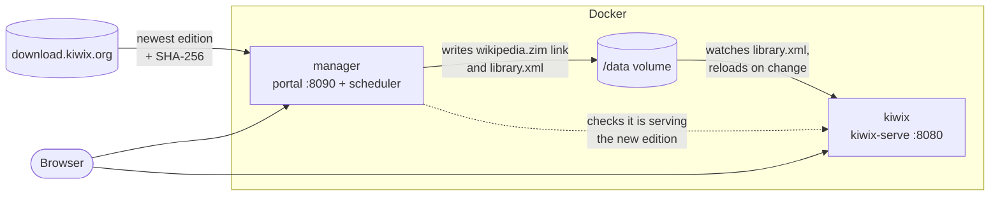

# Kiwix Auto Download Manager

Keeps an offline copy of Wikipedia up to date. It downloads the newest [Kiwix](https://kiwix.org) ZIM edition of your choice on a schedule and serves it with `kiwix-serve`. A small web portal lets you choose the language, edition and schedule.

> [!WARNING]
> **This project is under active development and is being built with the help of [Claude](https://claude.ai), Anthropic's AI assistant.** Expect rough edges: some features may be incomplete, may change without notice, or may not work as described. Please test it before relying on it, and [open an issue](https://github.com/ChrisTracy/Kiwix-Auto-Download-Manager/issues) if something breaks.

## How it works

Two containers share one data volume:



1. **Find the newest edition.** On each scheduled check the manager reads the listing at `https://download.kiwix.org/zim/wikipedia/` and finds the newest `wikipedia_<language>_<edition>_<YYYY-MM>.zim` for your settings. You pick a language and edition, not a month, so it always tracks the latest release.
2. **Download and verify.** If that file is newer than what is being served, the manager downloads it into the volume while the current edition keeps serving. Interrupted downloads resume where they stopped. The file is checked against the `.sha256` that Kiwix publishes next to it.
3. **Switch over.** The manager points the `wikipedia.zim` link at the new file and rewrites `library.xml` using `kiwix-manage`.
4. **Reload.** `kiwix-serve` watches `library.xml` and reloads within about a second. There is no restart, and the library stays at the same address (`/content/wikipedia`), so bookmarks keep working.
5. **Clean up.** Once `kiwix-serve` confirms it is serving the new edition, the old file is deleted (unless *Keep previous editions* is on).

The manager never touches Docker itself and **does not need the Docker socket**.

## Quick start

Requirements: Git, Docker with Docker Compose, and enough disk space. English *Everything, with images* is about **120 GB**, and an update briefly needs room for two editions.

### 1. Get the code

```sh
git clone https://github.com/ChrisTracy/Kiwix-Auto-Download-Manager.git
cd Kiwix-Auto-Download-Manager
```

### 2. Add your settings

Put your settings in a file named `docker-compose.override.yml` next to `docker-compose.yml`. Docker Compose merges it in automatically, and git ignores it, so `git pull` never conflicts with your changes.

```yaml
services:
  manager:
    environment:
      ADMIN_PASSWORD: pick-a-password   # portal login; any username works
      WIKI_LANG: en                     # first-run language
      WIKI_FLAVOR: all_maxi             # first-run edition
      TZ: America/Chicago               # first-run time zone for schedules
```

See [Configuration](#configuration) for every setting.

### 3. Start it

```sh
docker-compose pull
docker-compose up -d
```

This uses the prebuilt image [`christracy/kiwix-auto-download-manager`](https://hub.docker.com/r/christracy/kiwix-auto-download-manager) from Docker Hub, published for **x86-64 (amd64)** and **ARM64** (Raspberry Pi 4/5, Apple silicon, ARM servers). Nothing is built on your machine.

Then open:

| Address | What it is |
|---|---|
| http://localhost:8090 | Manager portal. Log in with any username and the `ADMIN_PASSWORD` you set. |
| http://localhost:8080 | The Wikipedia library served by kiwix-serve. |

The first start downloads the chosen edition right away. Progress shows in the portal. Until the download finishes, the library on port 8080 is empty.

> On newer Docker installs, `docker compose` (with a space) does the same as `docker-compose`.

### Updating

```sh
cd Kiwix-Auto-Download-Manager
git pull                 # picks up changes to docker-compose.yml
docker-compose pull      # downloads the newest images
docker-compose up -d     # recreates only the containers whose image changed
```

Your downloaded editions and portal settings live in the `data` volume, so they survive updates.

### Building from source instead

To run your own changes instead of the published image, add `build: .` to the `manager` service in your `docker-compose.override.yml`:

```yaml
services:
  manager:
    build: .
    environment:
      ADMIN_PASSWORD: pick-a-password
      WIKI_LANG: en
      WIKI_FLAVOR: all_maxi
      TZ: America/Chicago
```

Then start and update with `--build`, so Compose rebuilds the image from your copy of the code:

```sh
git pull
docker-compose up -d --build
```

## The portal

- **Status:** what is being served, whether a newer edition exists, download progress, and whether the library is online.
- **Check now:** look for a new edition immediately.
- **Language and edition:** for example *Everything, with images* (`all_maxi`), *Everything, no images* (`all_nopic`) or *Article intros only* (`all_mini`). Changing these starts a download of the new choice.
- **Schedule:** manual only, every N minutes/hours/days/weeks, daily, chosen weekdays, monthly (by date or by "2nd Sunday"), or a custom cron expression, all in a time zone you choose. The portal previews the next few run times. *Run a missed check at startup* catches up on a check that was due while the manager was off.
- **Keep previous editions:** keep old files instead of deleting them after a switch.
- **On disk / Activity:** the files in the volume, free space, and a log of recent actions.

## Configuration

Set these in the `manager` service's `environment:` section. Language, edition and schedule are only **first-run defaults**: after that the portal's saved settings (in `/data/.manager/state.json`) take precedence.

| Variable | Default | Purpose |
|---|---|---|
| `ADMIN_PASSWORD` | *(none)* | Password for the portal (basic auth, any username). **Set this.** If it is empty, the portal is open to anyone who can reach it. |
| `WIKI_LANG` | `bm` | First-run language code, such as `en`, `de` or `fr`. |
| `WIKI_FLAVOR` | `all_maxi` | First-run edition, such as `all_maxi`, `all_nopic` or `all_mini`. |
| `TZ` | `UTC` | First-run time zone for schedules, such as `America/Chicago`. |
| `SCHEDULE_CRON` | *(unset)* | Optional first-run cron schedule. Without it, checks run Sundays at 04:00. |
| `KIWIX_URL` | `http://kiwix:8080` | How the manager reaches kiwix-serve inside the compose network. |
| `KIWIX_PORT` | `8080` | Host port of the library, used for the portal's "Library online" link. |
| `BASE_URL` | `https://download.kiwix.org/zim/wikipedia/` | Where editions come from. A mirror must offer the same directory listing and file names. |
| `PORT` | `8090` | Port the portal listens on inside the container. |

The `kiwix` service must run with `--monitorLibrary --library /data/library.xml` (already set in `docker-compose.yml`).

## Data volume layout

```
/data
├── wikipedia.zim                         → link to the edition being served
├── wikipedia_en_all_maxi_2026-08.zim     the edition itself
├── wikipedia_en_all_maxi_2026-10.zim.part   a download in progress (resumable)
├── library.xml                           what kiwix-serve serves (written by the manager)
└── .manager/state.json                   saved settings and schedule state
```

## Troubleshooting

- **The portal or library shows `ERR_EMPTY_RESPONSE` right after starting.** The container is up, but the app inside isn't listening yet. Wait a few seconds. On the very first start the `kiwix` container may restart once, until the manager has created `library.xml`.
- **"Library offline" in the portal.** The manager can't reach kiwix-serve at `KIWIX_URL`. Check `docker-compose logs kiwix`.
- **"Not enough disk space".** The manager checks free space before downloading and keeps 512 MB spare. Free up space or choose a smaller edition.
- **A check failed.** The error appears in the portal and the manager retries automatically after an hour.
- **Logs:** `docker-compose logs -f manager kiwix`

## Development

The manager is plain Python 3 (standard library only) plus the `kiwix-manage` binary, which the Dockerfile copies from the official `ghcr.io/kiwix/kiwix-tools` image.

| File | Contents |
|---|---|
| `app.py` | Web server, API, download, verify and switch-over logic |
| `schedule.py` | Schedule validation, cron parsing and next-run calculation |
| `index.html` | The portal (single page, no build step) |

### Publishing to Docker Hub

`.github/workflows/docker-publish.yml` builds the image for `linux/amd64` and `linux/arm64`:

- **Pull requests:** build only, to catch errors. Nothing is pushed.
- **Pushes to `main`:** push `latest` and `sha-<commit>`.
- **Version tags like `v1.2.3`:** push `1.2.3`, `1.2` and `1`.
- **Manual run:** *Actions → Publish Docker image → Run workflow*.

One-time setup in the GitHub repository, under *Settings → Secrets and variables → Actions*:

| Secret | Value |
|---|---|
| `DOCKERHUB_USERNAME` | Your Docker Hub username |
| `DOCKERHUB_TOKEN` | A Docker Hub [access token](https://app.docker.com/settings/personal-access-tokens) with *Read & Write* access |

The image is pushed to `<DOCKERHUB_USERNAME>/kiwix-auto-download-manager`.

## License

[Apache License 2.0](LICENSE). Wikipedia content is published by the Wikimedia Foundation under CC BY-SA. ZIM files are produced by the Kiwix project.
